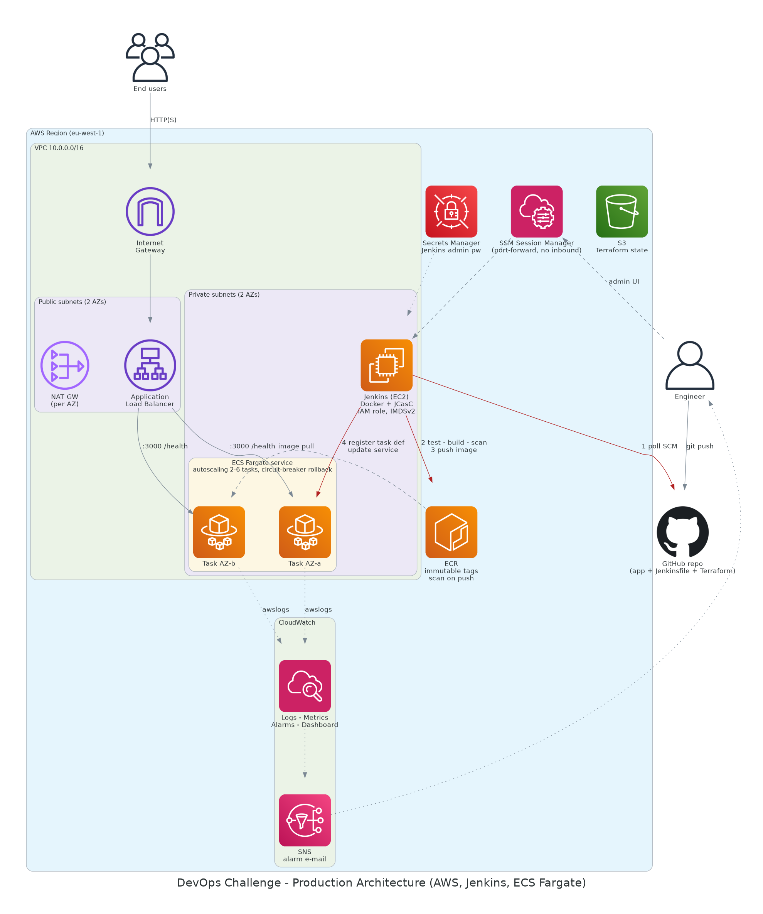

# DevOps Challenge – Production-Ready Deployment on AWS

A small Node.js service deployed to **AWS ECS Fargate** behind an **Application Load Balancer**, with all infrastructure defined in **Terraform** and a **Jenkins** pipeline (itself provisioned by Terraform and configured as code) that tests, builds, scans, pushes and deploys the container with **zero manual steps**.



## 1. Architecture overview

| Layer | Choice | Notes |
|---|---|---|
| IaC | Terraform ≥ 1.10, modular (`network`, `ecr`, `alb`, `ecs`, `jenkins`, `monitoring`) | Remote state in S3 with native lockfile |
| CI/CD | **Jenkins** on EC2 (private subnet) | Dockerised controller, plugins + job + security defined with Jenkins Configuration as Code |
| Registry | ECR | Immutable tags (git SHA), scan on push, lifecycle policy |
| Compute | ECS **Fargate**, 2–6 tasks across 2 AZs | Autoscaling on CPU/memory, deployment circuit breaker with auto-rollback |
| Ingress | Public ALB (HTTP, or HTTPS + redirect when an ACM cert is supplied) | Tasks are only reachable from the ALB security group |
| Observability | CloudWatch Logs, Container Insights, alarms, dashboard, SNS e-mail | JSON app logs, log-based error metric |
| Container | Multi-stage Dockerfile | Tests run inside the build; non-root, read-only root FS at runtime |

### CI/CD flow (`Jenkinsfile`)
```
git push → Jenkins polls SCM (2 min) → Test → Build → Trivy scan → Push to ECR → Deploy to ECS → Smoke test
```
1. **Test** – `docker build --target test` runs `npm test`; failure stops the pipeline.
2. **Build** – runtime image tagged with the 8-char git SHA (`APP_VERSION` baked in).
3. **Scan** – Trivy fails the build on fixable `CRITICAL` CVEs.
4. **Push** – ECR login via the instance role (no stored credentials); push is skipped if the tag already exists (tags are immutable → re-runs are idempotent).
5. **Deploy** – `scripts/deploy.sh` registers a new task-definition revision with the new image, updates the service and polls ECS until the rollout is `COMPLETED`. If ECS's circuit breaker rolls back, the script **fails** the build instead of reporting false success.
6. **Smoke test** – checks that the public URL serves the version that was just deployed.

## 2. Repository layout
```
app/                    Node.js (Express) sample service, tests, multi-stage Dockerfile
Jenkinsfile             Declarative pipeline
scripts/                deploy.sh (ECS deploy + rollback detection), bootstrap-backend.sh
infrastructure/
  bootstrap/            One-time S3 state bucket
  modules/              network | ecr | alb | ecs | jenkins | monitoring
  envs/prod/            Root module that wires the modules together
docs/                   architecture.png + the script that generates it
```

## 3. Deployment steps

**Prerequisites:** an AWS account + credentials with admin-level rights for the initial apply, Terraform ≥ 1.10, AWS CLI v2, the [Session Manager plugin](https://docs.aws.amazon.com/systems-manager/latest/userguide/session-manager-working-with-install-plugin.html), and this repo pushed to a **public** GitHub repo (Jenkins clones it anonymously).

```bash
# 1. Create the remote-state bucket (one-time) and generate backend.hcl
./scripts/bootstrap-backend.sh eu-west-1

# 2. Configure and apply the environment
cd infrastructure/envs/prod
cp terraform.tfvars.example terraform.tfvars      # set repo_url + alarm_email
terraform init -backend-config=backend.hcl
terraform apply

# 3. Wait ~5-8 min: the Jenkins host installs Docker, builds its image and starts.
#    Open Jenkins through SSM (there is no inbound access to the instance):
$(terraform output -raw jenkins_port_forward_command)     # keep running, then browse http://localhost:8080
$(terraform output -raw jenkins_admin_password_command)   # user: admin

# 4. The job "devops-challenge-app" already exists. It builds automatically on the first poll
#    (or press "Build Now"). Every later push to main triggers the pipeline.

# 5. Verify
curl "$(terraform output -raw app_url)/"          # {"service":"devops-challenge-app","version":"<git sha>",...}
```
Confirm the SNS e-mail subscription (link sent to `alarm_email`) to receive alarms. The CloudWatch dashboard is named `devops-challenge-prod`.

> **Expected on first apply:** the service is created with 0 tasks because no image exists yet. The first pipeline run pushes the image and scales the service to `min_tasks`. The "running tasks low" alarm can fire briefly until then.

**Run the app locally**
```bash
cd app && npm ci && npm test && npm start        # http://localhost:3000
```

**Teardown:** set `allow_destroy = true`, `terraform apply`, then `terraform destroy` (this disables ALB deletion protection and lets ECR/Secrets Manager be removed). The state bucket is protected by `prevent_destroy`.

## 4. Design decisions

- **ECS Fargate over EC2/EKS** – no hosts to patch for the workload, per-task IAM and security groups, fastest path to a robust deployment. EKS would be over-engineered for one service.
- **Jenkins on EC2, but private** – the server has *no inbound rules*; admins use SSM port-forwarding, so there is no public Jenkins UI to attack and no SSH keys to manage.
- **Jenkins as code** – plugins pinned in `plugins.txt`, security realm, global env vars and the pipeline job all live in `casc.yaml`. Rebuilding Jenkins is `terraform taint` + apply; nothing is clicked in a UI.
- **No static AWS credentials** – Jenkins uses its instance role, scoped to: push to one ECR repo, update one ECS service, register task definitions, pass the two task roles, read one secret.
- **Pipeline owns releases, Terraform owns infrastructure** – the ECS service ignores `task_definition`/`desired_count` changes, so `terraform apply` never reverts a deployment or fights autoscaling.
- **Immutable, SHA-tagged images** – every running container traces back to a commit; no `latest`.
- **Safe rollouts** – min 100 % healthy / max 200 %, ALB health checks, circuit breaker with rollback, and a pipeline that detects the rollback.
- **Network** – ALB in public subnets, tasks and Jenkins in private subnets, NAT per AZ, locked-down default SG, VPC flow logs (rejected traffic) to CloudWatch.
- **Monitoring** – alarms for ALB 5xx, unhealthy targets, low running tasks, CPU, memory, application error logs (JSON log metric filter) and Jenkins host status; all notify SNS.
- **Modules** – each module has one responsibility and typed inputs/outputs, so `envs/staging` can reuse them with different variables.

## 5. Assumptions
- Single AWS account and region (`eu-west-1` by default); the default VPC is not used.
- The GitHub repo is public (or Jenkins is given a credential – see improvements).
- No custom domain was provided, so HTTP is the default. Passing `certificate_arn` enables HTTPS with a TLS 1.3 policy and an HTTP→HTTPS redirect.
- Jenkins polls Git (every ~2 min) because it has no public endpoint for webhooks.
- The sample app is stateless; no database is required.

## 6. Limitations and possible improvements
- **Jenkins is a single instance** with state on its root volume. Job history is lost if it is rebuilt (config is not). Improvements: separate EBS volume + DLM snapshots, or ECS-based Jenkins agents.
- **Docker socket is mounted** into the Jenkins container (builds run on the host daemon), which is effectively root on that host. Mitigated by the private, inbound-free host; better: ephemeral build agents or Kaniko/BuildKit rootless.
- **Webhooks / private repos**: add an internal ALB + WAF or a GitHub-hosted trigger, and a GitHub credential stored in Secrets Manager.
- **Single environment** – add `envs/staging` and a manual-approval promotion stage.
- **Cost** – NAT gateway per AZ (~US$65/month) is the largest fixed cost; set `single_nat_gateway = true` for demos. VPC endpoints (ECR, S3, CloudWatch) would reduce NAT traffic.
- **Extras to consider** – WAF on the ALB, ALB access logs, KMS CMKs for logs/secrets, blue/green via CodeDeploy, Terraform plan checks (`tflint`, `checkov`) in CI, Docker Hub pull-through cache to avoid rate limits.
